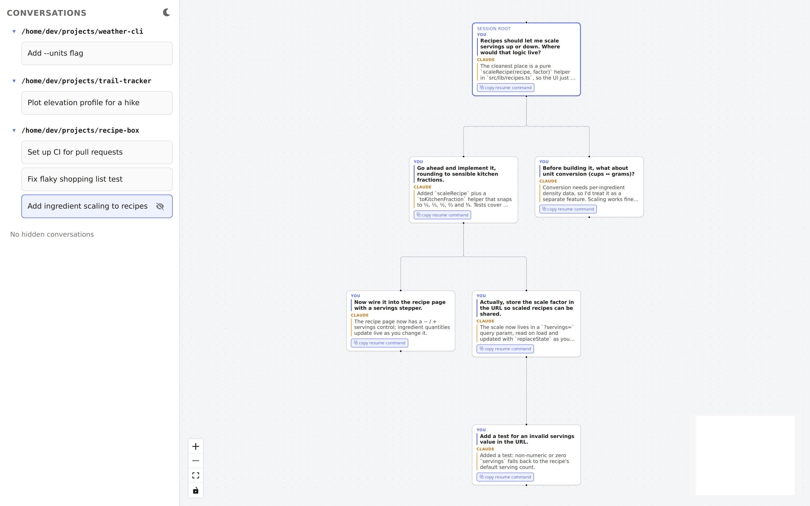

# Claude Tree

A conversation tree manager for [Claude Code](https://claude.com/claude-code). It indexes your existing Claude Code conversations (stored locally under `~/.claude/projects/`) into a browsable, branching tree, and lets you fork a new, independently-resumable session from any past turn — without ever touching the original conversation.

- **Automatic tracking** — every Claude Code conversation becomes a tree; every prompt/response becomes a node. Updates live as you use Claude Code.
- **Branch from any point** — click a turn to fork the conversation up to that point into a new session, and copy a ready-to-run `claude --resume ...` command to paste into your own terminal.
- **Non-destructive** — branching always creates a brand-new session file. The conversation you branched from is never modified, so you can always get back to it.

<picture>
  <source media="(prefers-color-scheme: dark)" srcset="docs/screenshot-dark.png">
  
</picture>

## Prerequisites

- Node.js 22+ (the exact version used for development is pinned in the root `package.json`)
- An existing `claude` CLI install, reachable on `PATH` (used both for indexing your conversation history and for the resume/branch feature)

## Getting started

```bash
npm install
npm run build
```

Then, in two terminals:

```bash
# Terminal 1 — backend: backfills your existing ~/.claude conversation history,
# then watches for live changes and serves the API on http://127.0.0.1:4317
npm run start --workspace packages/server

# Terminal 2 — frontend dev server (proxies /api and /ws to the backend above)
npm run dev --workspace packages/web
```

Open the URL Vite prints (typically `http://localhost:5173`). You should see a project list on the left; pick one to see its conversation forest.

For iterating on the backend itself, `npm run dev --workspace packages/server` runs it directly from source via `tsx` instead of the compiled build.

### Desktop app

Claude Tree can also run as an Electron desktop app, which starts the backend in-process and serves the built frontend from it — no separate terminals needed.

```bash
# Build everything and launch the desktop app from source
npm run electron:dev

# Build installers for the current platform into packages/electron/release/
npm run electron:package
```

Packaging produces a `.dmg`/`.zip` on macOS, an AppImage and `.deb` on Linux, and an NSIS installer on Windows. The desktop app keeps its database in the platform's per-user app data directory, and only one instance runs at a time (launching it again focuses the existing window).

### Branching

Click a turn in the tree to see its action:
- **⧉ copy resume command** — forks the conversation up to that point into a new session and copies a shell command (`cd '<project dir>' && claude --resume <new-session-id>`) to your clipboard so you can continue in your own terminal.

(There was previously also a "⑂ branch" button that opened a live embedded terminal instead of copying a command; it's removed for now since copy-resume-command covers the need, but the underlying fork/resume machinery it used is untouched — see the doc comments on `TurnNodeData.onCopyResumeCommand` in `packages/web/src/tree/turnGraph.ts` for exactly how to bring it back.)

## Running tests

```bash
npm test
```

Runs the full Vitest suite (unit + integration-style tests against fixture data). Tests never touch your real `~/.claude/` directory — they run against temporary fixture directories, guarded by a runtime check that refuses to operate on your real Claude home.

## Safety notes

This app only ever *reads* from `~/.claude/projects/`, with exactly one exception: branching creates a brand-new session file under a freshly-generated UUID, written with an exclusive-create flag so it can never overwrite an existing file. Nothing under `~/.claude/` is ever modified or deleted by this app.

## Project structure

```
packages/
  shared/   — DTOs shared between server and web
  server/   — indexer (backfill + live file watching), SQLite DB, REST/WebSocket API, branch/resume logic
  web/      — React + @xyflow/react frontend
  electron/ — desktop app shell that runs the server in-process and opens the UI in a window
```

## Configuration

- `CLAUDE_TREE_PORT` — override the backend's port (default `4317`); also respected by the desktop app

## Known limitations

- No automated browser/UI tests — frontend logic is covered by unit tests on the underlying data transforms, not rendered-DOM tests (see `packages/web/src/tree/turnGraph.test.ts`).
- Single-user, local-only tool: no authentication, and the server binds to `127.0.0.1` only.
- On WSL2, the file watcher uses polling (rather than native filesystem events) to avoid a known conflict where native watching kills WebSocket connections in the same process.
